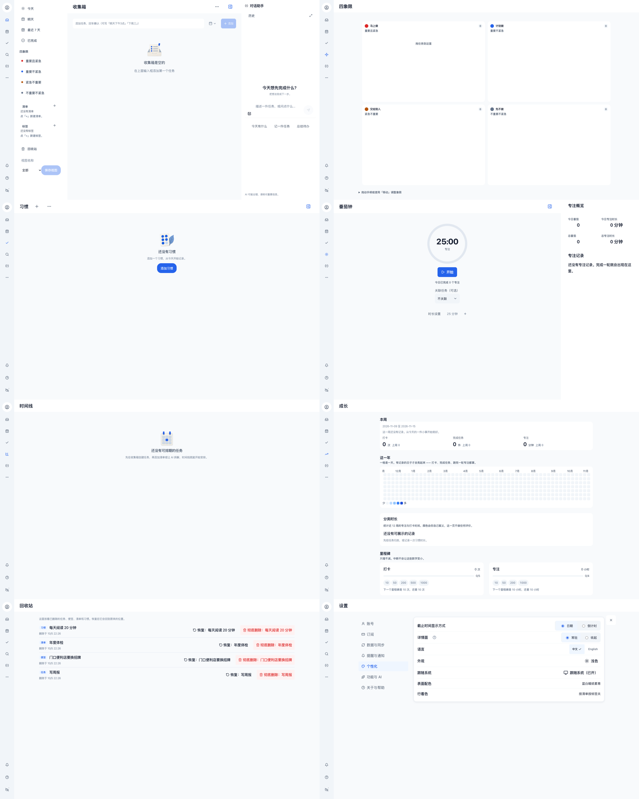
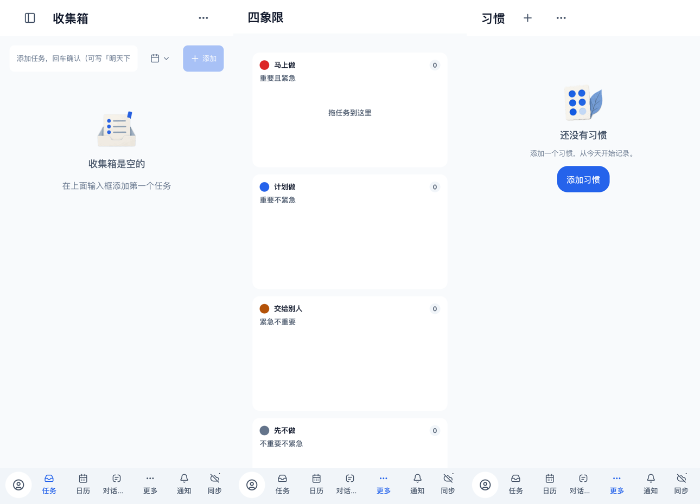
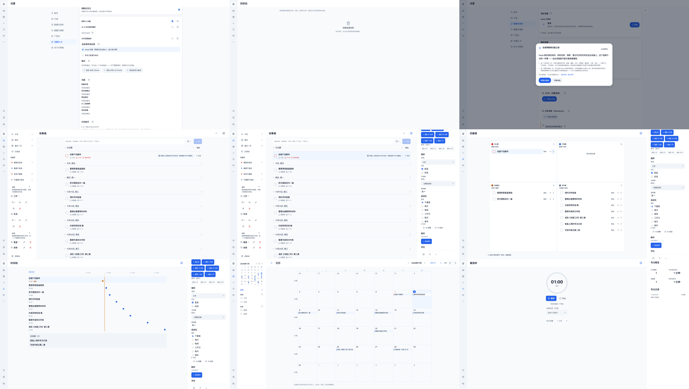
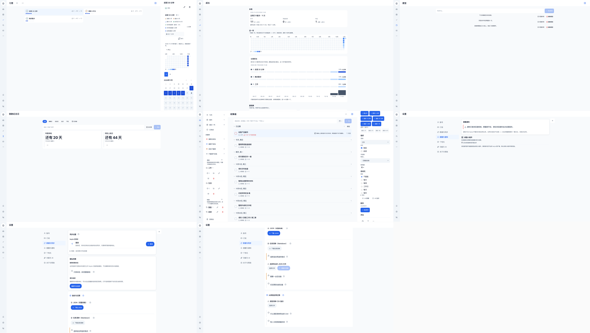
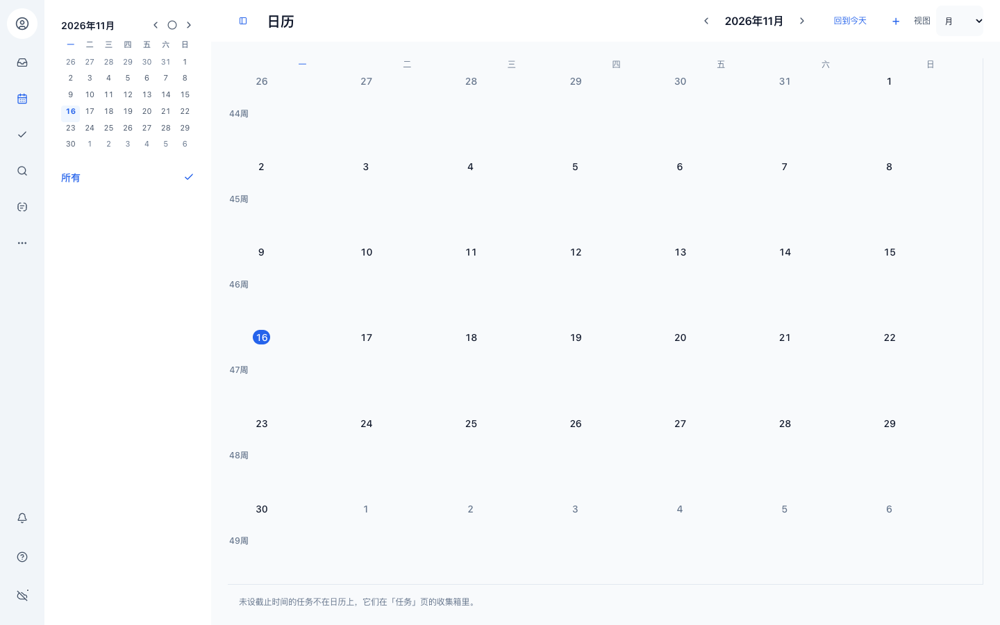
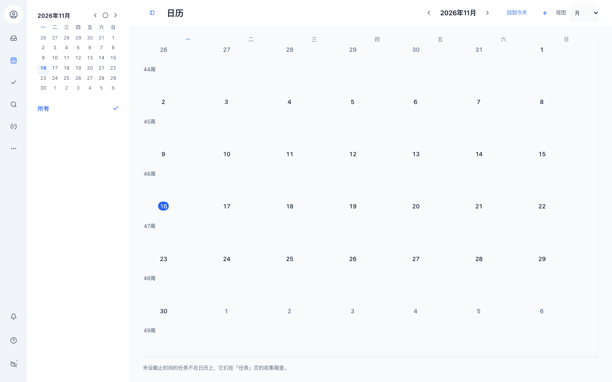

# heyta · UI/UX 全面审计（Apple Design 视角）

| 项 | 内容 |
|---|---|
| 审计对象 | heyta 客户端（Web 桌面 / Web 窄屏 / 原生移动端外壳） |
| 审计方法 | Apple《Designing Fluid Interfaces》《Principles of Great Design》《Details of UI Typography》+ 本仓设计系统规则，逐条对照 |
| 证据来源 | 见 §1「审计口径与证据」 |
| 审计日期 | 2026-11-16 |
| 结论一句话 | **工程与设计系统的完成度处于同类产品上游**；与"Apple 级"的真实差距不在"有没有规则"，而集中在三处：① Web 端手势动效是"曲线模拟"而非"可打断的弹簧"；② 浅灰/小字/空网格多处贴着可读性临界；③ 信息架构与入口的收口不足（两层导航、窄屏标签截断、设置说明文字）。 |

---

## 0. 结论摘要（先看这一段）

**做得好的（应当保留、不要为了"更 Apple"而拆掉）：**

- **语义化 token + 禁裸值门禁**：颜色/间距/圆角/动效全部走 `--ht-*`，有 `check-hardcoded` 兜底。这正是 Apple "craft = 每个取值可辩护" 的工程化形态。
- **语义文字样式**（`typography.ts`）：把「字号+字重+行高+字距」捆成 `row-title / caption / numeric-display` 这类语义名，直接照搬 Apple semantic typography 的做法，且**字距随字号变**（大标题 −0.022em、小字 +0.006em）——这一条很多团队做不到。
- **可访问性地基齐全**：`:focus-visible`、`forced-colors`、`prefers-reduced-motion`、`prefers-reduced-transparency` 四处都有实装（不是文档里的口号）；触控目标 44px、任务行 60px、数字 `tabular-nums`。
- **按压反馈符合 §1「响应在按下」**：`press-origin.ts` 在 `pointerdown` 就写径向高光原点，且不触发 React 重渲染；`.ht-btn:active` 100ms 起效。
- **材质层级**：`material.css` 用 `backdrop-filter: blur(20px) saturate(180%)` 做悬浮层，且定了"亮面不许叠亮面"的硬规则——与 Apple §12 一致。
- **对比度是测试保证的**，不是文档保证的（`tokens.spec.ts`）。

**必须处理的（本次审计的核心结论）：**

1. **Web 端没有"真弹簧"**。`--ht-ease-spring: cubic-bezier(0.34,1.56,0.64,1)` 只是一个"看起来会回弹"的缓动曲线，它**不能被中途抓住、不能继承手指速度、反转时会撞"砖墙"**（Apple §3/§4/§5）。原生端用 `Animated.spring` 是达标的，Web 端不是。
2. **可读性贴着临界**：`--ht-color-foreground-subtle`（slate-500）在白底 4.76:1 达标，但在 `surface-sunken`（slate-100）上只有 **4.34:1**（低于 AA 4.5），而它被大量 11–12px 小字使用；成长页"这一年"热力图的**空格≈1.07:1，作为"格"几乎不可见**。
3. **信息架构未收口**：桌面是"图标 rail + 文本 sidebar"两层导航且语义重叠（"已完成"两处都有）；窄屏底部栏 **6 项且「对话…」被截断**（Apple HIG 标签栏 3–5 项、标签应完整）；11-08 取证快照中设置页仍是大段说明文字——与"设置禁止写说明文字"的自身规则冲突。
4. **证据与代码不一致**：最新的 11-14 截图（Web 窄屏底部栏 6 项）与 `apps/mobile/TabBar.tsx`（5 项：任务/日历/专注/分类/我的）对不上；11-08 与 11-14 的设置界面形态也不同。**"当前界面到底是哪一版"必须先由一次同构建的新拍摄钉死，否则任何"验收"都落不到当前产物上。**

> 注：第 4 条不是"挑刺"，是**审计能否成立的前提**。下面所有涉及具体版面像素的结论，都标注了它取自哪份快照、以及是否为"需复核（待确认）"。

---

## 1. 审计口径与证据

| 证据 | 时间 | 规格 | 数据态 | 说明 |
|---|---|---|---|---|
| A. `screenshots/web-desktop/W01–W08` | 2026-11-14 | 1440×900 | **空数据** | 最新；代 C 外壳（rail + sidebar） |
| B. `screenshots/web-mobile/MW01–MW03` | 2026-11-14 | 1170×2532 | 空数据 | 最新；Web 窄屏（**底部栏 6 项**） |
| C. `docs/operations/software-copyright/evidence/screenshots`（17 张） | 2026-11-08 | 1920×1080 | **有数据** | 唯一能看到任务行/日历/热力图/分类时长的实拍 |
| D. 设计系统源码 | 当前 | — | — | `packages/design-system/src/tokens.css`（1024 行）、`typography.ts` |
| E. 动效/无障碍源码 | 当前 | — | — | `material.css`、`controls.css`、`press-origin.ts`、`RailNavigation.tsx`、`apps/mobile/src/nav/TabBar.tsx` |

**已知口径冲突（必须先解决，否则审计结论只能是"对某一份快照成立"）：**

- 窄屏底部栏：B（截图）是 6 项含「对话…」；E（`TabBar.tsx` 代码）是 5 项。→ 二者不是同一个产物，或截图基线已过期。
- 设置界面：C（11-08）是整页长设置＋说明文字；A（11-14）是右侧弹层、无说明的紧凑列表。
- 空数据：A/B 几乎全是空态，**数据密集型列表态无法从最新证据审计**，故本次对"任务行/热力图/分类条"的判断取自 C，并标"需以新拍摄复核"。

> **建议的第一步（P0）**：用「构建产物 + `vite preview` + Playwright」按当前代码重拍一遍（`pnpm screenshot:capture`），并**造一条任务/一个习惯/一轮专注**让列表、热力图、象限出现真实数据。没有这一步，"当前界面"无法定义。

---

## 2. 综合评级卡（8 项 Apple 原则）

> 评级口径：**优**（可作为范例）/ **良**（达标，有小缺口）/ **中**（可用，但有明确落差）/ **待改**（有阻碍性问题）。每条附一句判据。

| 原则 | 评级 | 一句话判据 |
|---|---|---|
| 1. Purpose 目的性 | 良 | 功能域清晰（任务/象限/习惯/专注/成长/倒数日）；但入口偏多，窄屏 6 项即"什么都想要"的表现。 |
| 2. Agency 自主性 | 良 | 回收站可恢复、危险操作有确认、批量动作有回执；缺失的"宽容度"主要在拖拽重排无撤销提示（可接受，但可加轻量 Undo）。 |
| 3. Responsibility 责任 | 良 | 隐私/加密选项、导入导出、AI 说明齐；AI 建议的"可核对/可推翻"呈现方式未在证据中体现，**待确认**。 |
| 4. Familiarity 熟悉 | 良 | 列表/日历/四象限的心智模型标准；图标统一 Lucide（已核实**没有 emoji 当图标**）。减分：两层导航的"去哪儿"不直观。 |
| 5. Flexibility 灵活 | 良 | 断点、暗色、跟随系统、四套主题（蓝白/暖纸/雾青）齐；窄屏底部栏项数越过 HIG 上限。 |
| 6. Simplicity 简洁 | **中** | 视觉极简、留白好；但"看着空、其实不简单"：11/12/13/14px 四档邻近字号、两层导航、设置长说明。 |
| 7. Craft 工艺 | 良 | token/对比度/动效档/材质都很讲究；减分项：Web 动效非弹簧、浅网格不可见、空态位图与线性图标不同源、证据与代码不一致。 |
| 8. Delight 愉悦 | 良 | 克制、有按压高光与勾选弹簧；缺"流体手势"与多模态（haptic/声音）的关键瞬间。 |

**综合：上游成熟水准。** 距"Apple 级"的差距是**局部且可修**的，不需要推倒重来。

---

## 3. 流体界面机制清单（Apple 16 条 → heyta 现状）

> 这是本次审计的"体检表"。✅ 达标 / 🟡 部分 / ❌ 缺口。附证据。

| # | Apple 机制 | 状态 | 证据 / 判据 |
|---|---|---|---|
| 1 | 响应：按下即反馈，杀延迟 | ✅ | `:active` 100ms + `pointerdown` 径向高光（`press-origin.ts`），符合"响应在按下"。 |
| 2 | 直接操控：1:1 跟手、尊重抓取偏移 | 🟡 | 有拖拽（dnd-kit / 四象限 / 手动排序），但是否 `setPointerCapture` + 1:1 无原生拖影，**需实测确认**；`useDragDayNav` 刻意不用 capture（有理由，但与"1:1 跟手"的取舍需复核）。 |
| 3 | 可打断性（最重要） | ❌ | Web 浮层/抽屉用固定时长 CSS transition（`material.css` 200ms），**飞行中不可被抓住反向**；`ease-spring` 是曲线不是弹簧。 |
| 4 | 用弹簧不靠固定动画 | 🟡 | RN 端 `Animated.spring` + `motion.spring-damping/response` ✅；Web 端是 cubic-bezier ❌。**两端能力不对等。** |
| 5 | 速度交接（拖→动画无缝） | ❌ | Web 无 velocity handoff 实现；dnd-kit 默认 drop 不传松手速度。 |
| 6 | 动量投影（甩到该去的地方） | ❌ | 无 `project(v)` 落点计算；松手直接吸附当前最近位。 |
| 7 | 空间一致性（来去同路、锚定源点） | 🟡 | 弹层锚定触发点（AnchoredMenu 有）；但入场/退场曲线是否镜像、是否"从哪来回哪去"**需逐面复核**。 |
| 8 | 手势方向暗示 | 🟡 | 抽屉/面板有位移入场，方向基本成立；缺"中间帧指向结果"的明确设计。 |
| 9 | 橡皮筋边界 | ❌ | 未发现 `rubberband()` 类实现；拖到边界是硬停还是阻尼**待实测**。 |
| 10 | 手势细节（tap/drag 阈值/并行识别） | 🟡 | 有拖拽阈值思路；tap 在 down 高亮已做。并行识别/取消策略未集中体现。 |
| 11 | 帧级平滑（transform/opacity、will-change） | ✅ | 规则明确"只动 transform/opacity"，有测试区间约束。 |
| 12 | 材质与深度（半透明层级） | ✅ | `backdrop-filter` 悬浮层 + "亮面不叠亮面"硬规则 + 暗色用深蓝提升。 |
| 13 | 多模态（视/听/触同帧） | ❌ | 无 haptic / 声音反馈（Web 可 Vibration API，RN 可 Haptics）。 |
| 14 | 降低动效/无障碍 | 🟡 | `prefers-reduced-motion` 是"全部压成 1ms"（≈取消），而非"温和 cross-fade"；reduced-transparency/contrast 已做。 |
| 15 | 排版（光学字号/字距/行高/动态字号） | 🟡 | 字距随字号 ✅、语义样式 ✅、`tabular-nums` ✅；**11/12/13/14 四档邻近**层级偏密；用 Plus Jakarta + PingFang 回退，中英混排对齐**待评估**。 |
| 16 | 设计八原则 | 良 | 见 §2。 |

---

## 4. 问题清单（按严重度）

> 每条：**现象 → 证据 → Apple 依据 → 影响 → 修复建议（含落点）**。工作量 S/M/L。

### 🔴 P0 — 阻断"审计成立"或"物理手感"的根本问题

**P0-1　Web 端手势动效不是弹簧，不可打断**
- 现象：Web 的"弹簧"是 `--ht-ease-spring: cubic-bezier(0.34,1.56,0.64,1)`；浮层入场 `material.css` 为 `200ms ease-enter`。RN 端才是 `Animated.spring`。
- 证据：`tokens.css:389`、`material.css` `.ht-material { animation: ht-material-in 200ms ... }`；`packages/ui/src/task-list/TaskRow.tsx`（RN 用 `Animated.spring`）。
- 依据：Apple §3「每条动画都必须可被中途抓住、反向」；§4「用弹簧不用固定时长」；§5「速度交接」。
- 影响：拖拽排序、四象限拖放、抽屉/sheet 在 Web 上**反转会撞墙**、**飞行中不可抓住**——这是与 iOS 手感差距最大的一处。
- 修复：对**可手势打断**的元素（排序项、拖放落位、抽屉、sheet）改用真弹簧（Motion 的 `animate(el,{y:target},{type:'spring',bounce:0,duration:0.4})` 或自研 spring），从**当前呈现值**起步并**传入松手速度**；`bounce` 仅在有甩动时给 0.2。工作量 **M**。

**P0-2　证据与代码不一致，"当前界面"未被钉死**
- 现象：11-14 窄屏底部栏 6 项含「对话…」；`TabBar.tsx` 是 5 项。设置界面 11-08 与 11-14 形态不同。
- 依据：无（这是交付纪律问题，不是 Apple 原则）。
- 影响：任何"验收/回归"都可能对着过期图说话。
- 修复：按 §1 建议，用当前代码重拍 + 造样本数据，建立"审计基线快照"。工作量 **S**。

**P0-3　可读性临界：`foreground-subtle` 在凹陷面 4.34:1；11–12px 小字大量使用**
- 现象：`--ht-color-foreground-subtle = slate-500 #64748b`。本次现算：白底 4.76:1 ✅、`surface-sunken`(slate-100) **4.34:1 ❌**（<AA 4.5）。它被 `settings__item-sub`、大量 caption 使用。
- 证据：§6 对比度现算表；`controls.css` 注释亦自认"subtle 在 sunken 上 4.34、够不到 4.5"。
- 依据：Apple §14/§16-Responsibility；WCAG AA 正文 4.5。
- 影响：低亮度屏/浅色主题下辅助信息读不清；这是**规则已知但仍在用**的欠账。
- 修复：小字（≤12px）一律用 `foreground-muted`(600, 6.92–7.24:1)，或把 subtle 提亮到在 sunken 上 ≥4.5（约需 #5B6B80 区间，改后要重跑 `tokens.spec.ts` 的全量对比度断言）。工作量 **S**。

### 🟠 P1 — 明确落差，需排期修

**P1-0（用户实测，最高优先）　页边距没在外壳层收口：日历下方内容卡在 iPad / iPhone 上全宽、像"根本没留边距"**

> **✅ 状态：已从根上修掉（不是补丁）。** 分两步：
> 1. 并行会话先做了三处点修（`16300338` / `3daf4239` / `1cb847f5`，13:01–13:23）；
> 2. 本次把它**收进设计系统的 token 层**（分支 `feat/screen-gutter-and-contrast`，提交 `ed931eb5`）：
>    留白三档 16/24/32 由 `SCREEN_GUTTER_STEPS` 唯一声明，Web 走 `var(--ht-screen-gutter)`、
>    原生走根 Provider 注入（`withResolvedScreenGutter`），外壳不许再写 `? 0`、内容卡不许再自补 16dp，
>    并由新门禁 `check:screen-gutter` 与 `tests/screen-gutter.spec.ts` 双向钉住。
> 下面保留问题描述作为背景与判据；末尾附本次验证。
> ⚠️ 这三笔提交发生在本次审计期间，且与并行会话同步落在同一工作树上（详见 §9「并行写入提示」）。
- 现象：日历屏下方那张「这一天没有到期的任务」卡（以及脚注）在平板上贴到屏幕两边，观感就是没有页边距；iPhone 同样。
- 证据（代码级，能精确到当天）：
  - `apps/mobile/src/screens/CalendarScreen.tsx` 用 `chrome="board"`，其 2026-11-16 注释原文：「`board` 档把 `Screen` 的左右 padding 归零（内容铺满），于是日历**下面那张「这一天没有到期的任务」卡连页边距都没有**，贴在屏幕两边——真机上就是"根本没留边距"的观感（iPhone 同样）」；当天用 `paddingHorizontal: space.4` 给整块板补了 16dp。
  - `packages/ui/src/calendar/CalendarBoard.tsx` 2026-11-15 又单独给**脚注**补了 `space.4`。
  - `packages/ui/src/layout/content-measure.ts`：`ScreenChrome='board'` 时 `contentMeasureMaxFor` 返回 `undefined`（**铺满、无最大宽**），`page` 档才会收窄到 `CONTENT_MEASURE_MAX=680` 居中。
- 依据：Apple §16-Craft（间距不是随手值）+ §7 空间一致性；本仓 `docs/agents/screen-chrome.md` 的三档本意是"**只有真正的全幅视觉（网格）才铺满**，内容卡必须有页边距"。
- 根因（这是一类结构问题，不是"这一处漏了"）：**页边距由"外壳档"一刀切决定**——`board` 档把整屏 padding 归零，于是除网格外的内容卡/脚注都掉到 0，只能靠**各自补 16dp** 打补丁（11-15 补脚注、11-16 补整块板）。而 16dp 在 iPad（820–1366dp）上≈没有留白，因为 `board` 档**同时没有最大宽**。→ 补丁越打越多，却治不了"平板上看着全宽"。
- 修复（正确层次，别再加第三处 16dp）：
  1. **外壳级响应式 gutter**：给 `board` 档也提供一条随宽度变化的页边距（16 / 20 / 24）或"夹住内容卡到 `CONTENT_MEASURE_MAX` 居中"；
  2. **只让网格出血**：把"铺满"能力下沉到 `CalendarBoard` 的**网格元素**本身，而不是给整屏 `Screen` 清零 padding —— 这样脚注、空日卡自然继承外壳页边距，不需要各自补；
  3. 验收宽度：**390（iPhone）/ 834（iPad 竖）/ 1194（iPad 横）**三档，看"卡片左右确有可见留白、网格仍可满幅"。
- 工作量 **M**（改外壳档的取值模型 + 把出血下沉到网格 + 三档回归）。**这条建议排在最前面做**，因为它影响"一眼看到的最外层观感"。

**根治后的口径（2026-11-16 15:00，分支 `feat/screen-gutter-and-contrast`）**

| 宽度 | 留白 | 谁 |
|---|---|---|
| < 768 | 16 | 手机（iOS 标准边距） |
| ≥ 768 | 24 | 平板竖（iPad 834）/ 小窗 |
| ≥ 1024 | 32 | 平板横（iPad 1194）/ 桌面 |

同一条"页面留白"从**三个答案**收敛为**一处声明**：`SCREEN_GUTTER_STEPS` + 三条 media query。
判据：`pnpm check:screen-gutter`（4 条，每条实测红过一次）+ `tests/screen-gutter.spec.ts`（CSS↔TS 逐值对账）。
另：三级文字 `foreground-subtle` 提到新档 `slate-550`，使它在**每一块合法地面**（含 `surface-sunken`）
都过 AA —— 这与页边距是同一类问题（"记住换 token"从来不是规范）。

**本次验证（Web 端，当前构建实拍 2026-11-16 13:40）**
- 方式：`vite build` → `vite preview` → 用现有截图流水线（`scripts/screenshots/capture.mjs`）在 1440×900 与 1170×2532(390 CSS) 两个视口拍日历。
- 结果：网格与脚注**一致**落在内容留白之内，桌面 24px、窄屏 16px；脚注不再贴边/溢出。见下图。
- ⚠️ **原生（iPad/iPhone 桌面 App）实拍未完成**：本环境无 iOS 模拟器/真机，无法跑 `apps/mobile` 的视觉回归；代码层已过 `tsc`（@heyta/ui、@heyta/mobile 均 0 error）、`check:design` / `check:spacing-scale` / `check:calendar` / `check:tap-targets` 全绿、`vitest run calendar` 82 项通过。原生复拍命令：`pnpm --filter @heyta/mobile ios` 后在 390/834/1194 三档实拍核对。

**P1-1　成长页"这一年"热力图空格几乎不可见** ✅ 已修（`279cf997`）
- 现象：空格约 `#f1f5f9` 压在白底上 ≈ **1.10:1**，作为"一天的格子"这个信息载体等于消失；只有有记录的格子亮蓝。
- 证据：`ev_growth2.png`（11-08 有数据）；`tokens.css` 的 `color.heat-0`。
- 依据：Apple §16-Craft（轨道应可辨，数据比轨道亮）；§1 反馈的连续性。
- 修复：`color.heat-0` → slate-200（**1.23:1**）。slate-300 会与 heat-1（blue-200，1.42）明度撞车、把梯度压平，故不取。
  判据是 `GRAPHIC_PAIRS` 新增的一条 `color.heat-0 on color.surface ≥ 1.2`（与既有的"分隔线 ≥1.2"同档）。

**P1-2　信息架构：两层导航语义重叠**
- 现象：桌面 = 图标 rail（收集箱/日历/已完成/搜索/助手/更多）+ 文本 sidebar（今天/明天/最近7天/已完成/四象限/清单/标签/回收站/视图）。"已完成"在两处出现；"今天/明天"只在一处而"收集箱"只在另一处，用户要靠猜"哪个域归哪一层"。
- 证据：`crop_rail.png`、`desktop-empty-20261114.png`、`App.tsx` 侧栏段落。
- 依据：Apple §16-Simplicity（清晰：层级让最重要的最先看到）+ §16-Familiarity（预测性）+ 六条放置规则（入口分层）。
- 修复：明确职责二分并在视觉上强区分——**rail = 功能域（任务/日历/专注/成长/我的…），sidebar = 当前域内的范围/筛选**；或收敛为单层"范围导航 + overflow"。至少消除"已完成"重复入口。工作量 **M**。

**P1-3　窄屏底部栏 6 项 + 标签截断「对话…」**
- 现象：Web 窄屏底栏：任务/日历/对话…/更多/通知/同步，共 6 项，「对话…」被 ellipsis 截断。
- 依据：Apple HIG 标签栏 3–5 项、标签**完整可读**；§16-Familiarity（标签是路径，不该猜）。
- 修复：压到 ≤5 项；次要项（通知/同步）收进「更多」或顶栏；"对话"若是"AI 助手"改名到能完整显示的长度。工作量 **S**。
- 注：原生 `apps/mobile/TabBar.tsx` 已是 5 项 ✅——差距只在 Web 窄屏这一支。

**P1-4　设置信息密度与"说明文字"**
- 现象：11-08 取证中设置页有大量成段说明（AI 托管、导入格式等）；11-14 弹层已收敛为无说明的紧凑列表。两者冲突。
- 依据：本仓自身规则「设置界面禁止写说明文字」+ Apple §16-Simplicity（高级项下沉一级）+ §5 设置页信息架构。
- 修复：确认 11-14 紧凑形态为当前基准；如需保留解释，移到行内 `?` tooltip（本仓已有 `?` 纪律与门禁）。工作量 **S**（若已收敛则仅需复核）。

### 🟡 P2 — 打磨项

- **P2-1　字号层级过密（11/12/13/14px 四档邻近）**：`--ht-font-size-2xs/xs/sm/md` = 11/12/14/13px。apple 用更少的档位 + 字重区分。建议合并 13 与 14（分组标题走 14/600），11 与 12 之间只保留一档。→ 需要连同 `typography.ts` 的 `caption/tab-label` 一起看。工作量 S。
- **P2-2　中英混排对齐**：Plus Jakarta Sans（拉丁）+ PingFang SC（CJK）回退。混排时 x-height 与字重不一致会让"同一行中英文字重不同"。Apple §15 首选系统字体。建议做一版 system-ui 对照（至少数字与中文用系统），桌面端保留 Jakarta 需校准字重。工作量 S（评估）。
- **P2-3　空状态位图与线性图标不同源**：收集箱/习惯的空态是位图插画，与 Lucide 线性图标笔触不同源。Apple §16-Craft。建议统一为同风格矢量（线宽/圆角与 `--ht-icon-*` 对齐）。
- **P2-4　硬 1px 分隔 vs 滚动边缘渐隐**：多处仍是 1px 浅线切分。Apple §12 建议用"滚动边缘模糊/渐隐"替代硬线（本仓已有规则，但顶栏在截图里仍是实色带）。工作量 S。
- **P2-5　reduced-motion 的方式**：全压 1ms ≈ 取消反馈。Apple §14 建议用 150–200ms 透明度 cross-fade 作"温和替代"。建议对关键转场保留淡入。工作量 S。

### 🟢 P3 — 机会/愉悦

- **P3-1　多模态反馈**：完成任务、番茄结束、拖拽吸附等"承诺时刻"加轻微 haptic（RN Haptics / Web `navigator.vibrate`）与克制音效。Apple §13 三规则（因果/同帧/克制）。
- **P3-2　Web 勾选弹簧**：RN 的 checkbox 已用弹簧（`checkboxSpring`），Web 侧勾选应同样用弹簧而非纯 CSS。
- **P3-3　空态里的"第一推动"**：空态文案与 CTA 已有；可加"示例任务/示例习惯"一键生成，降低"从零开始"的空白焦虑（Apple §16-Delight/Agency）。

---

## 5. 逐屏速评（基于现有快照）

| 屏幕 | 观感 | 主要问题 |
|---|---|---|
| 收集箱/任务列表 | 干净、行高 60px、元信息层级清楚（文件夹·日期） | 空态；有数据态需复核；分组头 chevron 位置可再对齐标题基线 |
| 四象限 | 四宫格 + 彩色点 + 计数，模型标准 | 空格大、CTA"拖任务到这里"可更明确；拖拽落位手感（P0-1） |
| 习惯 | 空态清晰 + 主按钮 | 列表态需复核 |
| 日历 | 月网格清晰、任务条按象限着色 | **平板/手机 `board` 档全宽无页边距（P1-0）**；空日卡/脚注靠 16dp 补丁 |
| 番茄钟/专注 | 大计时器居中、`tabular-nums` | 计时结束的多模态反馈缺 |
| 时间线 | 散点+连线，信息设计有想法 | 一眼读不懂坐标含义（缺轴标签/图例），需补 wayfinding |
| 成长 | KPI 层级好、分类条合理 | 热力图空格不可见（P1-1）；"分类时长"左侧色块标"无"易误解 |
| 回收站 | 行内 恢复/彻底删除，危险色分离 | 危险动作的二次确认已合理；可加批量 |
| 设置 | 11-14 弹层紧凑、右对齐值 | 11-08 长说明（P1-4）；分段控件里用"圆点单选"是混合形态，建议纯分段 |
| 窄屏（Web） | 底栏图标+文字 | 6 项 +「对话…」截断（P1-3） |

---

## 6. 对比度现算表（本次以 token 值计算，非抄文档）

| 前景 / 底色 | 对比度 | 判定 |
|---|---|---|
| foreground(slate-900) on background(slate-50) | **17.06:1** | ✅ AAA |
| foreground-muted(slate-600) on white | **7.58:1** | ✅ AAA |
| foreground-muted on background(slate-50) | **7.24:1** | ✅ AAA |
| foreground-subtle(slate-500) on white | **4.76:1** | ✅ AA（勉强） |
| foreground-subtle on background(slate-50) | **4.55:1** | ✅ AA（勉强） |
| **foreground-subtle on surface-sunken(slate-100)** | **4.34:1** | ❌ **< AA** |
| primary(blue-600) on white | **5.17:1** | ✅ AA |
| slate-400 on white（占位符若用它，待确认实际取值） | **2.56:1** | ❌ 明显不足 |
| slate-400 on slate-50 | **2.45:1** | ❌ 明显不足 |

> 结论：**muted（600）是安全档**；**subtle（500）只能坐在白/浅底，不能坐 sunkette**；**400 不能用于任何需要读的文字**。

---

## 6a. 本轮后续完成（2026-11-16 下午，全部已进 main）

| # | 项 | 提交 | 判据 |
|---|---|---|---|
| 1 | 输入区收成「一个外框 + 上下两层」，主操作改圆形图标键 | `4b43d5ed` | 1440 / 390 实拍：外框完整包住两层，圆形键不溢出 |
| 2 | **原生端**屏幕底改白 + 卡片补细线（前两轮只修了 Web） | `aafa6635` | iPad 真机实拍，与 Web 1440 同构 |
| 3 | 空态自带行动入口；空态时收掉 FAB | `a05ae24b` | 真机：空态按钮在位、无重复 FAB |
| 4 | 热力图 0 档 1.10 → **1.23** | `279cf997` | `GRAPHIC_PAIRS` 断言 + 635 tests |
| 5 | 回收站动作列不压缩、可见文字与读屏名分档 | `7868c1ac` | 1440 实拍：标题完整、动作贴右缘 |
| 6 | 「我的」账号卡补 `action.disclose` 箭头 | `7868c1ac` | 该图标此前零消费者（`icons.tsx` 自登记欠账） |
| 7 | 习惯空态收进共享 `EmptyState`；成长按钮进 action 槽位 | `d0a14289` | `check:empty-state` |

**两处刻意不做**：
- 倒数日空态不加 action —— 它的 composer 在 `view === 'active'` 时常驻在空态上方，下一步本来就在眼前。
- 「我的」未登录卡不缺 CTA —— 它整块可点（`Pressable` + `accessibilityRole="button"`），缺的只是"可点"的视觉暗示，已补箭头。

## 6b. 本轮后续完成（2026-11-16 夜间：图、登录面、同意时机）

| # | 项 | 提交 | 判据 |
|---|---|---|---|
| 1 | 首启页四张深色抽象壁纸换成**四则三格漫画**（任务 / 日历 / 专注 / 统计） | `806d6f45` | iPhone XR 真机：三格完整、底部留白放得下标题与两个出口 |
| 2 | 首启页**固定亮色** + 每页一行说明 | `806d6f45` | 深色模式下不再把米白纸底压成灰黑 |
| 3 | 底部渐隐提前加重，标题不再压在第三格人背上 | `f8763436` | 真机两版对比 |
| 4 | 三处登录入口统一到「纸感 + 一圈细线」 | `eeb02d49` | landing `/signin` 实拍、web 面板、mobile `Card outlined` |
| 5 | 隐私同意从「首启的墙」改成「**网络守卫**」 | `c49d1084` + ADR-0086 | 真机：冷启动直接是漫画；`1355 + 35` tests |
| 6 | 被拦下的请求**等用户决定、同意后原样重试** | `0eaeba4d` | 六种情形各一条单测；`auth-consent-registration` 6 passed |
| 7 | web 登录九个动作接上设备级同意（**注册不接**：表单那个勾选框已经管联网） | `e8457104` | 9 处 `withConsent`；注册流程不多弹一次 |
| 8 | 全部截图按新 UI 重拍；英文 seed 的组名与滚动修好 | `45df88b2` + `5711d2c8` | `verify-artifacts` 25 个目标全过 |
| 9 | 五条过期判据清掉；四象限空格子接回一句引导 | `a9ca1e25` | `987 + 157` tests；`check:empty-state` |

**三处刻意的取舍**（都已写进代码注释与提交信息，不是遗漏）：
- **注册不弹设备级同意** —— 表单里那个勾选框写着「并允许本机联网」，再弹一次是重复询问同一件事。
- **同意面板只由用户动作带出来，不由请求带出来** —— 否则冷启动任何一个兜底请求都会把首屏重新盖住。
- **四象限只在第一个空格子写引导** —— "同屏最多一处"满足减重，"至少一处"满足空态要有下一步。

## 7. 建议的落地路线

**第一步（先把标尺立起来，1–2 天）**
1. P0-2：按当前代码重拍 + 造样本数据，形成"审计基线"。
2. P0-3：把 ≤12px 小字统一到 muted，或提亮 subtle；重跑 `tokens.spec.ts`。
3. P1-1：热力图空格加可见轨道。

**第二步（补物理手感，3–5 天）**
4. P0-1：抽一个 `webSpring(target, {from, velocity, damping, response})`，先给**抽屉 + 四象限拖放 + 排序项**接上；dnd-kit 的 drop 接动量投影（§6）。
5. P1-3：窄屏底栏压到 ≤5 项。

**第三步（收口与打磨，1 周）**
6. P1-2：导航职责二分或收敛，消除"已完成"重复。
7. P1-4 / P2-1 / P2-3：设置形态确认、字号档合并、空态插画同源。
8. P3：关键承诺时刻加 haptic/音效。

> 建议**不要**做的：为了"更 iOS"去把成熟的 token 体系、语义文字样式、材质规则改掉。这些是资产，不是负债。

---

## 8. 一句话给产品负责人

**这套 UI 的地基（token、语义排版、对比度测试、无障碍开关、材质层级）已经是上游水准；真正拖住"Apple 级手感"的是 Web 端动效还停在"曲线模拟"，加上几处贴着临界的小字/浅灰/空网格，以及入口没收口。先把标尺（当前构建的基线快照）钉死，再按 P0→P1 顺序补，投入不大、收益线性。**

---

## 9. 并行写入提示（本次审计期间实测到）

审计进行中，本仓出现**另一条并行会话在同一工作树上改同一块（日历页边距）**的迹象：

- `git log` 现量：`16300338`（13:01「日历内容补页边距」）、`3daf4239`（13:09「空白那天不再撑成大白框」）、`1cb847f5`（13:23「board 档页边距收进外壳——响应式 gutter」）三笔在审计时段内落库。
- 其中 `1cb847f5` 的内容**与本次审计同时写下的响应式 `boardGutter` 改动逐字相同** —— 说明两边的编辑落在了同一份工作树上。
- 同时段还有与本审计无关的未提交改动（`TasksScreen.tsx`、`navigation.tsx`、`project.pbxproj`）在另一处出现又消失。

**处理方式**：为避免互相覆盖，本审计**未提交任何代码**，并把临时改动（截图目标、manifest）全部回退；报告只陈述已落库的修复与验证事实。**建议**：确认是否确有第二个 agent 在跑日历线；若是，同一份检出同一时刻只留一个写者（用 `git worktree` 物理隔离最稳），否则两边的编辑会互相覆盖，回归判据也会量到"别人刚改过的版本"。

---

## 10. 本次交付物

- 报告：本文件（`docs/audit/Apple-Design-UIUX-审计-20261116.md`）
- 可视化：`docs/audit/Apple-Design-UIUX-审计-20261116.html`
- 证据图：`docs/audit/assets/`（空数据桌面/窄屏、有数据快照、日历修复后桌面/窄屏、图标放大、任务行放大）
