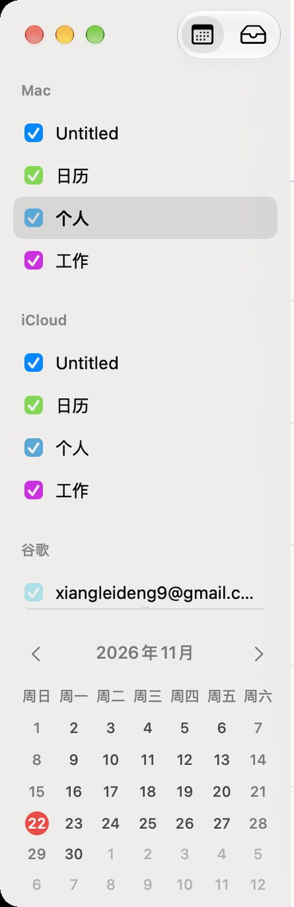
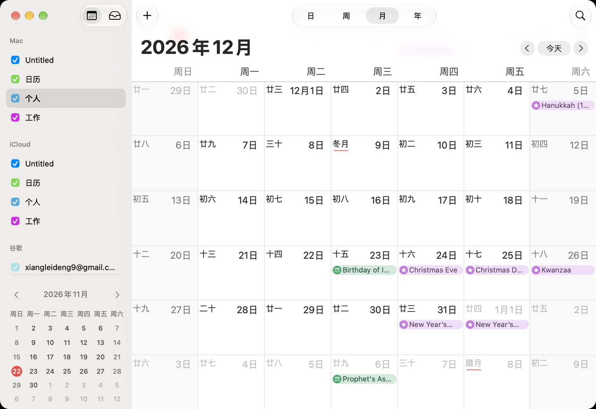
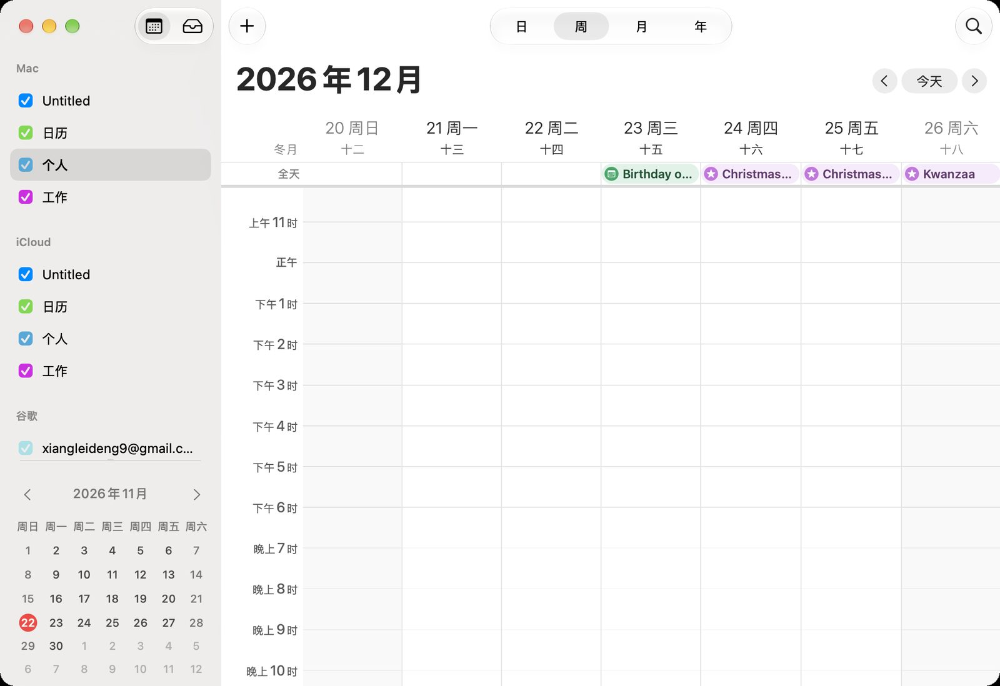
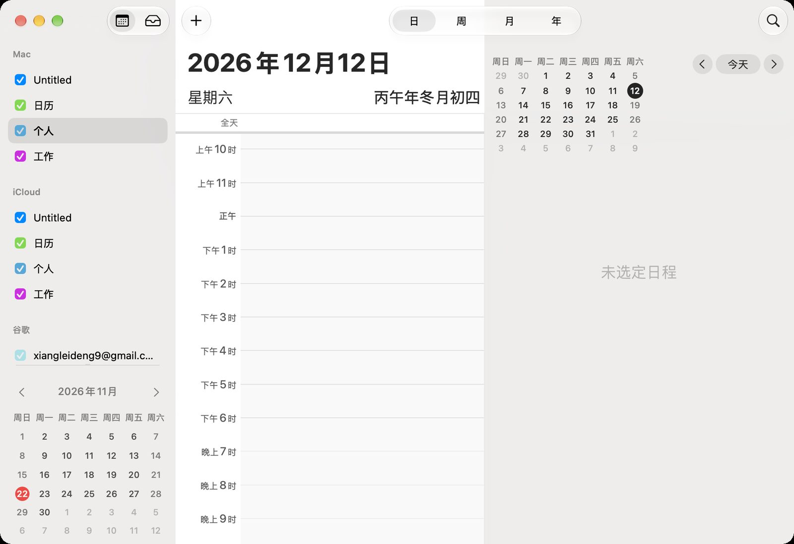
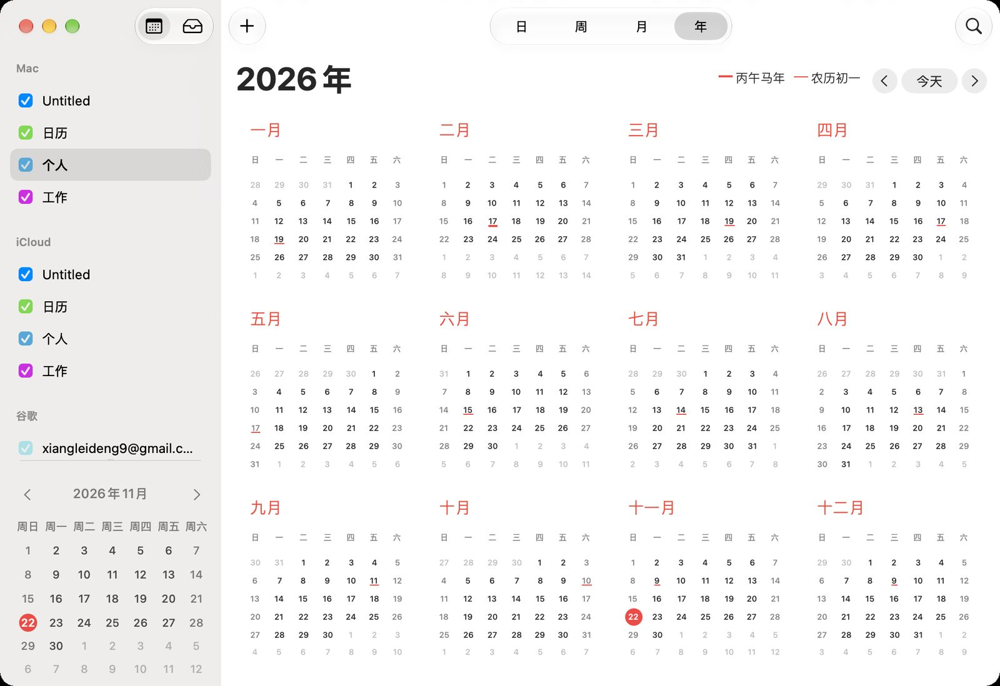

# macOS 自带「日历」App 排版布局拆解

> 取数：2026-11-22，本机 macOS（用户 rocalight），`/System/Applications/Calendar.app`。
> 方法：`huashu-mac-use` 内核后台截窗口（`mac shot <winid>`，Retina @2x 原生像素）+ `uiautomator`级 AX 元素表 + 像素采样（PIL）。
> 证据：截图 PNG 原图在 `.local/macos-calendar-layout/`（保留原图），本文内嵌图为压缩版 `img/`。
> 本文只描述**结构与量化事实**；凡未实测的数值一律标「待确认 / 目视估计」。
>
> 👉 **heyta 重排版式（目标版式 + 高保真稿 + 逐文件实施 + 测试影响矩阵）见 [`REDESIGN-SPEC.md`](REDESIGN-SPEC.md)。**

---

## 0. 与既有研究的关系（先把话说清）

| 对象 | 之前学过吗 | 在哪 |
|---|---|---|
| **滴答清单 日历（移动端）** | ✅ 学过，资源 id 级拆解（Android）。周视图两形态、视图档位选择器、任务页分块来源 | [`../ticktick-calendar/README.md`](../ticktick-calendar/README.md) |
| **滴答清单 桌面端（macOS + Windows）** | ✅ 逆向过；**两端布局基本一致**（Windows 是 WPF、macOS 是原生 Swift，界面同构）。但只取「数据模型/结构决定」，**不搬界面表达** | [`../ticktick-desktop-teardown-2026-11.md`](../ticktick-desktop-teardown-2026-11.md) |
| **Apple 系统 App（iPhone 端）** | ✅ 做过排版对照（提醒事项/备忘录/日历/时钟等），含 HIG 布局规范 | [`../apple-ui-ux-comparison-2026-11-18/`](../apple-ui-ux-comparison-2026-11-18/) |
| **macOS 自带「日历」App 的排版布局** | ❌ **没专门拆过**——本文补上 | 本文 |

**为什么单独拆这一份**：heyta 的日历要做「桌面级」的时间组织界面，而 macOS 日历是「桌面日历」最成熟的范式之一。它不是滴答，不受「不抄滴答界面」的约束；学习它的**网格节奏、信息层级、四视图切换**是正当的。红线仍是仓库既定的那条：**学结构与原则，不搬 Apple 的图标、具体美术与字体实现**（用 heyta 自己的 token）。

---

## 1. 全局框体：三段式 + 顶栏分两层

一天四视图共用同一套外壳，只有中间「内容区」按视图切换。

```
┌──────────────────────────────────────────────────────────────┐
│ ● ● ●   [日历|收件箱]        ＋   [日|周|月|年]         🔍    │ ← 第①层：标题栏工具条（透明，融进内容）
├──────────────────────────────────────────────────────────────┤
│ 侧栏（220pt）   │   大标题：2026 年 12 月          ‹ 今天 ›    │ ← 第②层：大标题头
│  · Mac          │ ────────────────────────────────────────────  │
│    ☑ Untitled   │   周日   周一   周二   周三   周四   周五  周六 │
│    ☑ 日历       │  ┌────┬────┬────┬────┬────┬────┬────┐        │
│    ☑ 个人 (选中) │  │    │    │    │    │    │    │    │        │ ← 内容区（按视图变）
│    ☑ 工作       │  ├────┼────┼────┼────┼────┼────┼────┤        │
│  · iCloud …     │  │    │    │    │    │    │    │    │        │
│  · 谷歌 …       │  └────┴────┴────┴────┴────┴────┴────┘        │
│  ‹ 2026年11月 ›  │                                              │
│  迷你月历        │                                              │
└──────────────────────────────────────────────────────────────┘
```

**实测框体尺寸**（窗口 995×683 pt，截图 1990×1366 px，1pt = 2px）：

| 项 | 实测值 | 取数 |
|---|---|---|
| 侧栏宽度 | **220 pt**（440px，占窗口 22.1%） | 扫描行找 `#EEECEB`→内容区分界，x=440/441 |
| 内容区宽度 | **775 pt** | 995 − 220 |
| 侧栏底色 | `#EEECEB`（暖浅灰） | 采样 (200,700) |
| 内容区底色 | `#F9F9F9`（极浅灰，非纯白） | 采样 (500,700) |
| 月格单元格底色 | `#FFFFFF`（比内容区更白） | 采样 (700,700)/(1000,700) |
| 网格线 | `#E5E5E5` | 采样 (882,700) |
| 大标题字色 | `#272727` | 采样 (520,165) |

**要点**：内容区底色 `#F9F9F9` 与单元格 `#FFFFFF` 之间只差一档亮度——**网格靠"白格浮在浅灰底上 + #E5E5E5 细线"表达**，不是靠深色描边。这是「安静」的关键。

---

## 2. 顶栏分两层（这是最值得学的一处结构）

macOS 日历没有把「标题 / 视图切换 / 搜索」塞进一根粗导航栏，而是**拆成上下两层、各有分工**：

**第①层 · 标题栏工具条**（高约 54pt，透明、与内容同底色，无分割线）
- 左：交通灯 → 一个**浮动胶囊分段控件**（两个图标：🗓 日历 / 📥 收件箱），即「日历 ↔ 提醒事项」在同一个 App 里切换。
- 中：一个圆形 `＋`（新建日程）。
- 中右：**分段控件 `日 | 周 | 月 | 年`**（选中项 = 灰色胶囊，非主色填充）。
- 右：放大镜搜索（圆形按钮）。

**第②层 · 大标题头**（在内容区内，随视图变）
- 左：**超大号当前范围标题**（月视图「2026 年 12 月」、年视图「2026 年」、日视图「2026 年 12月12日」+「星期六」+「丙午年冬月初四」）。
- 右：`‹  今天  ›`（上一段 / 回到今天 / 下一段），今天是中间那枚**带描边的胶囊**。

> 学到的结构原则：**「看哪一段」用大标题 + 今天按钮；「用什么视图看」用顶部小分段控件**。两者分开，标题就能做得很大、很稳，不会被一串控件挤小。

---

## 3. 侧栏



**结构（自上而下）**

1. **账户分组**：`Mac` / `iCloud` / `谷歌` 三组（组标题灰色小字，非加粗强调）。
2. **日历行**：`彩色圆角勾选框 + 日历名`。勾选框是**实心彩色方块 + 白色勾**（不是系统纯勾）；未勾选时是空框。颜色是用户给每个日历分的「日历色」（蓝/绿/品红等）。行高约 **28–32 pt**（目视 + AX 行间距 32pt）。
3. **选中态**：当前日历行 `个人` 有一整行**圆角灰底高亮**（不是只变字色）。
4. **迷你月历**（侧栏底部）：`‹ 2026年11月 ›` 头部 + `周日…周六` 单字表头 + 7×6 日期格；今天 `22` = **红色实心圆 + 白字**；非本月日期浅灰。

**要点**：侧栏同时承担「过滤（勾选哪些日历可见）」和「导航（迷你月历跳日期）」两件事，二者上下分区，不混。

---

## 4. 四种视图逐一

### 4.1 月视图（默认主力）



**实测几何**

| 项 | 实测值 | 取数 |
|---|---|---|
| 列数 / 列宽 | **7 列 × 111 pt** | 竖线 x≈660/882/1104/1326/1548/1768，间距 222px |
| 行数 / 行高 | **6 行 × 92 pt** | 横线 y≈452/636/820/1002/1184，间距 184px |
| 网格起止 | 从侧栏右缘（220pt）**贴边到窗口右缘**，左右无外边距 | 第一条竖线在侧栏边界处 |
| 表头一行 | `周日 … 周六`，字色 `#989898`，字高≈13.5pt | bbox 高 27px |
| 大标题字高 | **28 pt**（字面高，字号≈36–40pt，待确认） | dark bbox 高 56px |

**每个单元格的信息层级（自上而下）**

1. **农历日/月**（极小灰字，左上；如「廿一」「冬月」）——农历月初用**红色**（冬月、腊月红）。
2. **公历日号**（右对齐大字）；每月 1 号前带月份（`12月1日`）；非本月日期**浅灰**。
3. **事件 chip**：整行浅色胶囊，`小图标 + 文字`，放不下时**尾部省略号截断**（如 `Christmas D…`）。chip 底色是该日历色的浅调、文字用该日历色。

**颜色实测**
- 系统强调红（今天圆、农历月初）：`#E84840`
- 品红（某日历色）：`#C830E0`，其 chip 浅底如 `#EFDFF6`
- 绿（另一日历色）：`#80D050`

### 4.2 周视图



- **表头**：`日号 + 周几`（如 `20 周日`）大字，下面一行**农历小字**（如 `十二`；农历月初红色如 `冬月`）。
- **全天条**：表头下一条独立的 `全天` 行，**全天/跨天事件做成胶囊**铺在这一条里（可跨列）；与下面的时间网格用一条分隔线隔开。
- **时间网格**：左侧时间槽 + 7 列。**每小时一条 `#E5E5E5` 实线，半小时一条更浅的线**（目视）。时刻文案为本地化 12 小时制：`上午11时 / 正午 / 下午1时 … 下午6时 / 晚上7时 …`。
- **定时事件**按起止时间渲染为**竖直色块**（本抽样的周无定时事件，此形态为跨视图通用，待补一张有定时事件的样本）。

### 4.3 日视图（双栏）



- 左侧：**单日时间轴**（时间槽 + 一小时一格的网格 + `全天` 行）。
- 右侧：**窄栏** = 迷你月历（选中日本 `12` 为深色实心圆）+ 下方事件占位；空态文案 `未选定日程`（极浅灰，居中）。
- 大标题：`2026 年 12月12日` / 次行 `星期六` / 右侧 `丙午年冬月初四`（公历 + 星期 + 农历三段）。

> 日视图把「今天这一列」放大成主战场，右侧保留「在月里跳到哪天」的迷你月——**主视区 + 迷你导航**并置。

### 4.4 年视图



- **4 列 × 3 行 = 12 个月格**，每格一个迷你月（表头 `日 一 二 三 四 五 六` 单字 + 日期）。
- **月名中文数字、红色**（`一月 … 十二月`）——年视图里月名统一用强调色。
- 非本月日期浅灰；今天（11/22）红色实心圆。
- 顶部右：**图例** `— 丙午马年  — 农历初一`（红短线 + 说明），解释「红色代表农历/年名」。

---

## 5. 视觉系统实测汇总

| 维度 | 值 | 取数 |
|---|---|---|
| 强调红 | `#E84840` | 饱和红像素均值/众数 |
| 内容区底 | `#F9F9F9` | 采样 |
| 单元格底 | `#FFFFFF` | 采样 |
| 侧栏底 | `#EEECEB` | 采样 |
| 网格线 | `#E5E5E5` | 采样 |
| 主文字 | `#272727` | 采样 |
| 次文字（周几/农历/组标题） | `#989898` 一带浅灰 | 采样/目视 |
| 日历色样例 | 蓝 / 绿 `#80D050` / 品红 `#C830E0` / 红 | 采样 |
| 图标 chip 底 | 该日历色 ~10–15% 透明度浅调（如 `#EFDFF6`） | 采样 |
| 大标题字高 | 28pt（字号待确认） | bbox |
| 表头字高 | ~13.5pt | bbox |
| 分段控件选中 | 灰胶囊（`#E9E9E9` 一带），**不用主色填充** | 目视 |
| 圆角 | 胶囊/高亮行均大圆角（≈行高一半）；���格本身直角 | 目视 |

**文字层级策略**：靠**字号 + 字重 + 灰度**三分，不靠颜色堆——主信息近黑 `#272727`，次信息统一 `#989898`，颜色只留给「强调（红）与日历分类（彩色）」。

---

## 6. 交互与状态（可迁移的细节）

- **今日**：迷你月历/年视图里 = 红色实心圆 + 白字；周/月单元格里今天的具体处理本抽样未出现（今天不在所示月份），**待确认**。
- **选中**：侧栏日历行 = 整行圆角灰底；日视图迷你月里选中日 = 深色实心圆。
- **空态**：日视图右栏 `未选定日程`——**一句极浅灰的说明，不做插画**。
- **截断**：事件 chip 放不下时尾部 `…`，不换行、不缩字号。
- **分段切换**：`日/周/月/年` 用顶部胶囊分段，切换只换内容区，侧栏与大标题头结构不变。
- **层级导航**：不靠 push——「上一段/今天/下一段」用 `‹ 今天 ›` 就地翻页。

---

## 7. 可直接迁移到 heyta 的布局原则（可判红）

1. **外壳三段式固定**：左过滤/导航栏 + 右内容区 + 顶部两层（工具条 + 大标题头）。切视图只换内容区，外壳不动。
2. **标题与视图切换分层**：大标题只写「当前范围」，视图档位放顶部小分段控件。**判红**：大标题里塞控件 / 分段控件挤占标题 → 不合格。
3. **网格靠"白格浮浅灰底 + 1px 浅线"**，不用深描边。**判红**：网格线对比度过高、或给格子加深色边框 → 不合格。
4. **单元格信息三层**：辅助历法（极小灰）→ 日号（大字）→ 事件 chip（浅底彩字胶囊 + 截断）。**判红**：事件文字换行撑高单元格 → 不合格。
5. **今日与选中用"实心圆/整行底色"两种固定语言**，全局一致。
6. **周视图必须有独立的"全天条"**，与定时网格分离；全天/跨天事件走胶囊、定时事件走时间块。
7. **次信息统一一个灰**（`#989898` 一带），颜色只给强调与分类；**判红**：用多种彩色文字承担普通层级 → 不合格。
8. **空态一句话、极浅灰**，不加插画。

## 8. 不可照搬（红线）

- 不搬 Apple 的图标（生日蛋糕、星形节日图标等）、SF 字体实现、具体美术与像素值 → 用 heyta 自己的 design tokens 与组件。
- 不复制其截图文案以外的品牌元素。**学「结构与节奏」，不抄「皮」。**

---

## 9. 与 heyta 现状对照（不改结论，仅定位）

已知（来自 [`../apple-ui-ux-comparison-2026-11-18/BACKLOG.md`](../apple-ui-ux-comparison-2026-11-18/BACKLOG.md) 与代码）：
- **日历日/周/年视图 + now 红线 + 手势已在 `packages/ui/src/calendar/` 实现**（`CalendarDayBoard.tsx` 等）。
- **移动端**改成分段控件是**回退**（既有决策：移动端不用分段；日期/周/年用别的手势档位）。
- 因此本文的「桌面级四视图 + 分段控件」经验，**主要适用于 heyta 的桌面/Web 端**（含 Windows/macOS 桌面壳），不是回头去改移动端。

> 这块只是定位，具体要不要落、怎么落，按仓库流程走自己的 ADR/计划，本文不提工单。

---

## 10. 未取证 / 待确认

- **大标题精确字号**（字面高 28pt，字号区间未定）。
- **"今天"在周/月单元格内**的具体样式（本抽样今天不在所示月份）。
- **有定时事件的周视图**：定时事件色块的高度/叠放/并列算法（需一张含多小时事件的样本）。
- **深色模式**下的全部配色（本次只取浅色）。
- **窗口拉大后**的响应式（列宽是否会放宽等）——本次窗口 995×683，偏小。

（以上如需，可再开一轮针对性取证。）
