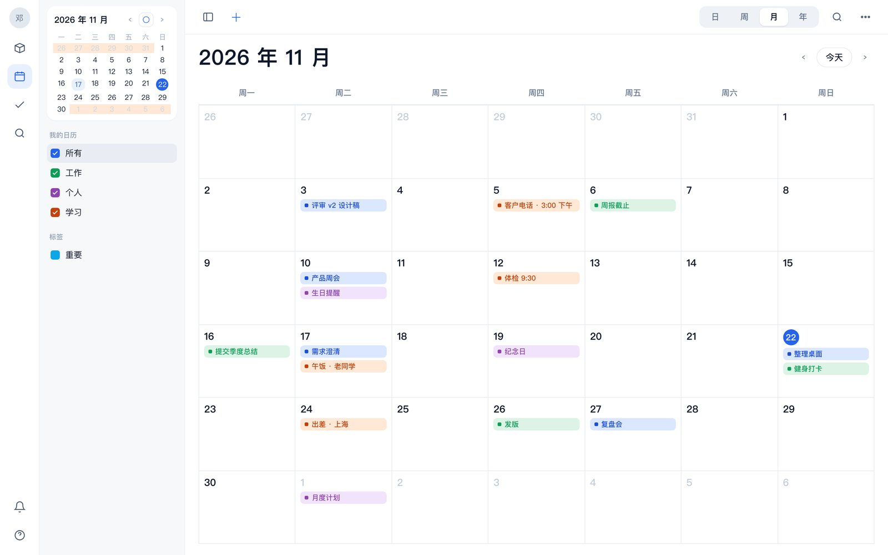
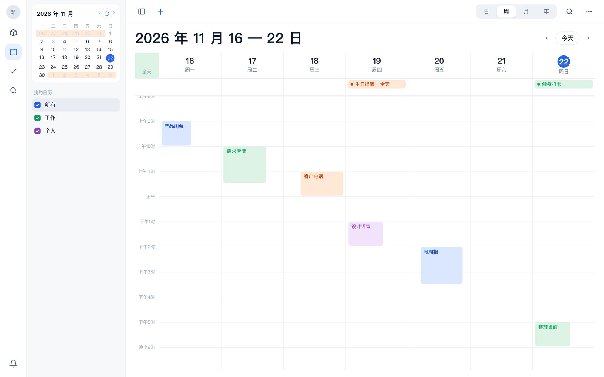

# heyta 日历「macOS 自带日历 × 滴答清单」综合体 · 重排版式规格

> 日期：2026-11-22　决策：产品负责人「完全对齐 macOS 日历 + 滴答清单的综合体；左右分栏 + 顶部导航栏是对的，现在这版是错的；UI/UX 全部借鉴」。
> 本文是**目标版的完整规格**（含高保真稿、量化结构、逐文件实施、测试影响矩阵），照此即可落地。
> 稿子是可运行的 HTML 源：`mock-src/{month,week}.html`（Playwright 渲染即可复现 `img/07`、`img/08`）。
> 底盘研究（macOS 日历原貌、量化）见同目录 [`README.md`](README.md)。

---

## 0. 一句话

**一屏 = 极窄应用图标栏（rail）+ 单一日历侧栏（迷你月 + 日历/标签勾选）+ 内容区；内容区用“两层顶栏”：上层工具条（分段 `日/周/月/年` + 新建 + 搜索 + ⋮），下层大标题（当前范围 + `‹ 今天 ›`）；主体是 7 列、白格浅线、无周数竖槽的网格。** 结构与交互对齐 macOS 日历，信息密度与“清单/标签”组织保留滴答特征。

## 1. 目标版式稿

**月视图（主战场）**

**周视图（全天条 + 时间网格）**

## 2. 结构规格（量化，照稿可写 CSS/token）

| 区块 | 规格 |
|---|---|
| 应用 rail | 宽 **64**；只放图标（当前视图用 `primary-subtle` 底 + `primary` 图标）；底部放通知/帮助 |
| 日历侧栏 | 宽 **236**；底色 `--color-background-subtle`（暖/中性灰，非纯白）；上=迷你月（圆角卡、`‹ ○ ›`），下=「我的日历」勾选列表 + 「标签」 |
| 内容区 | 底色 `#fff` |
| 顶栏·工具条 | 高 **56**；左：侧栏开关 + `＋`；**右对齐**：分段 `日 周 月 年`（选中=白底胶囊+阴影，未选=透明灰字）+ 搜索 + `⋮`；与内容用 1px `--color-border-subtle` 分隔 |
| 顶栏·大标题 | 高 **74**；左：**范围大标题 34px/700**（月=`2026 年 11 月`，周=`… — … 日`，日=日期，年=`2026 年`）；右：`‹  今天  ›`（今天=描边胶囊） |
| 网格·表头 | 高 **40**；7 等分；`周一…周日`（**周一开头**，与仓库既有数学一致）；周末列头可 `--color-danger` 弱红 |
| 网格·单元 | 7 列 × 6 行，等分；1px `--color-border-subtle` 拉格；白底；非本月 `foreground-subtle` |
| 单元格内容层级 | ①日号（16/600，今天=主色实心圆白字）②事件 chip（浅色底+同色字+前置 6px 方点，尾截断 `…`）——**无农历、无周数竖槽** |
| 事件色 | 取自（自有）日历色板：蓝/绿/紫/橙 各一组「浅底+深字」；不搬滴答/Apple 图标 |
| 周视图 | 表头（日号+周几）+ **独立「全天」条**（全天/跨天=胶囊）+ 时间网格（每小时实线、半小时更浅线；时刻用现有 `calendarHourMark` 本地化 12 小时制）；定时事件=竖直色块按起止定位 |

## 3. 与现状的差异（要改的点）

| # | 现状（见基线） | 目标 | 为什么 |
|---|---|---|---|
| D1 | 页标题是「日历」（小号，`font-size-lg`） | **范围大标题**（34/700） | macOS：页标题说“这一段”，不说 app 名 |
| D2 | 视图档位是 `视图 [月▼]` **原生下拉** | **分段 `日 周 月 年`** | macOS/TickTick 都用分段；一眼看全四档 |
| D3 | 网格左侧有 **`44周/45周…` 周数竖槽** | **去掉** | macOS 无；是“散”的主要来源。⚠️ 会改 `calendar-dida.spec` 判据（见 §5） |
| D4 | 底部一句 `未设截止时间的任务不在日历上…` | **去掉**（空态才需要时再给一句） | 常驻辅助文案＝噪音；未排期任务在任务页可见 |
| D5 | 顶栏控件从中间一路堆到右（`‹ 2026年11月 › 回到今天 ＋ 视图 ⋮`） | **两层**：工具条（分段/新建/搜索/⋮）+ 大标题（范围 + 今天） | 控件与标题分层，标题才稳得住 |
| D6 | 网格线几乎不可见、白格贴白底 | **1px 浅线拉格 + 侧栏/内容底分层** | 结构靠格线表达，不靠阴影 |
| D7 | 日历侧栏是浮动白卡 + `所有✓` | 迷你月卡 + 勾选列表分区（“我的日历/标签”） | 与 macOS 侧栏一致，勾选＝过滤语义清楚 |

**保留（综合体里滴答那一半）**：应用 rail（多模块导航）；侧栏“我的日历/标签勾选”组织；事件 chip 的“方点+浅底彩字”；`今天`/箭头就地翻页的手势与滚轮。

## 4. 实施清单（逐文件）

> 均为 **apps/web 桌面端**；移动端不动（移动端已用 `CalendarViewTabs` + 卡片内工具栏，另有既定决策）。

1. **`apps/web/src/features/calendar/CalendarHeaderToolbar.tsx`（主改）**
   - 结构改为：外层 `flex; justify-content:space-between`。
   - 左：**大标题**——按 `view` 取 `labels.monthTitle | weekTitle | dayTitle | yearTitle`（`stepCalendarCursor` 同一来源）。
   - 右：`CalendarToolbar`（改传 `hideTitle`，仅留 `‹ ›` + `今天`，保留其 `calendar-toolbar-*` testid）＋ `CalendarViewTabs`（来自 `@heyta/ui`，`options={CALENDAR_VIEW_ORDER}`）＋ `＋` ＋ `⋮`。
   - 视图切换换成 `CalendarViewTabs`（**移除** `<select data-testid="calendar-view-select">`）；「时间线」从下拉移入 `⋮` 菜单（`timelineEnabled` 时）。
   - `⋮` 菜单原有项全部保留。
2. **`apps/web/src/App.tsx`**
   - 日历视图下，`WebTopBar` 的 `title` 不再传「日历」——改为不渲染 h1（或传空并 `:empty{display:none}`），因为大标题已在 `CalendarHeaderToolbar` 左端；其余视图标题逻辑不动。
   - `leading` 的侧栏开关保留（移到工具条可再议）。
3. **`apps/web/src/features/calendar/useCalendarLabels.ts`**
   - `weekNumber` 不再提供（= 去 D3 竖槽）；`footnote` 不再提供（= 去 D4）。
4. **`packages/ui/src/calendar/CalendarBoard.tsx`（仅当坚持“共用一层也去”时才改；可选）**
   - 现状已按 `labels.weekNumber===undefined` 自动隐藏竖槽、`labels.footnote` 缺失即不画脚注 —— **web 端只要改 labels 即可，无需改共享板、无需重建 dist**。若要把移动端也统一，再改这里并 `pnpm --filter @heyta/ui build`。
5. **`apps/web/src/styles/app/main-area.css`（视觉）**
   - 新增日历页作用域类（给 `WebTopBar` 加 `className` 传日历标识）：
     - `.ht-header--calendar` 大标题字号/字重（`--font-size-2xl`→或新增 `title` 档）、工具条右对齐、两层高度。
     - `.ht-content__calendar-host` 网格线色用 `--color-border-subtle`（已用）；侧栏/内容底分层。
   - 全部走既有 `--ht-*` token；不写裸值（过 `check:design`）。
6. **`packages/design-system/src/tokens.css`（如需）**
   - 若缺「大标题」字号档，**先加 token**（如 `font-size.display` / `line-height.display`）再用；不得在 CSS 里造 `34px` 裸值。
7. **`packages/i18n/src/locales/{zh-CN,en}.ts`**
   - 复用现有 `CALENDAR_VIEW_LABEL_KEYS` 与 `common.calendar.view.*`；如需“搜索/新建”无障碍名已有；不新增句子（遵循“无冗余文案”）。

## 5. 测试影响矩阵（改版必须同步，否则红）

> 已实测：e2e 可在本机跑通（`HEYTA_E2E_APP_PORT=4418 HEYTA_E2E_STUB_PORT=4419`，缓存 chromium-1243）。下列按“改断言，不是改到绿”的原则：**产品意图变了，判据跟着变，并在用例注释写清新意图**。

| Spec | 现断言 | 改法 |
|---|---|---|
| `e2e/tests/calendar-view-options.spec.ts` | 读 `calendar-view-select` 的 option、`selectOption` 切档 | 改为对 `calendar-view-tabs-<kind>` 点击与 `aria-selected` |
| `e2e/tests/calendar-week.spec.ts` | `VIEW_SELECT='[data-testid=calendar-view-select]'` | 改 `clickTab('week')`（helper 统一） |
| `e2e/tests/calendar-year.spec.ts` / `calendar-day.spec.ts` / `calendar-day-en.spec.ts` / `countdown-calendar.spec.ts` | 同上（用 select 切档） | 统一改点击分段 tab |
| `e2e/tests/calendar-view-family.spec.ts` | 断言下拉 option 集合与顺序 | 改为断言分段 tab 文本集合与顺序（共享 `CALENDAR_VIEW_ORDER` 仍唯一来源） |
| `apps/web/tests/calendar-view-family.spec.tsx` | 读取 select option | 改为渲染 `CalendarViewTabs` 断言（该文件已 import `CalendarViewTabs`，收敛到组件本体） |
| `e2e/tests/calendar-dida.spec.ts` | 断言**周次列「31周」灰字**可见 | 改为断言**无周数竖槽**（或删除该条 + 在 README 记“去周数”新意图） |
| `e2e/tests/calendar-view.spec.tsx` | 断言 `calendar-board-footnote` 存在且含“未设截止时间” | 删除该断言（改为断言空态文案仅在有未排期时出现，或直接移除） |
| `e2e/tests/calendar-wheel.spec.ts` | 用 `calendar-board-footnote` 作为“滚轮负向”命中点 | 换命中点为网格外空白区（如 `.ht-content__calendar-host` 内非月卡区域） |
| `e2e/tests/assistant-navigation-acceptance.spec.ts:94` / `focus-visible-matrix.spec.ts:103` / `apps/web/tests/app-mount.spec.tsx:388` | 断言 `.ht-header__title`＝「日历」 | 改为断言**范围标题**（如 `2026年11月`）或标题存在即可（不再等于“日历”） |
| `e2e/tests/calendar-cells.spec.ts` / `calendar-sidebar.spec.ts` | 网格格数/周一开头/侧栏勾选 | **不动**（这些语义不变，正是要保留的） |

## 6. 落地顺序与验收

1. 建分支 → 改 §4 的 1/2/3/5（**不动 packages/ui，先免重建 dist**）→ `pnpm --filter @heyta/web typecheck` 绿。
2. 改 §5 的 web 单测 → `pnpm --filter @heyta/web test` 绿。
3. 改 §5 的 e2e → 跑受影响 spec（`calendar-view-options / calendar-week / calendar-year / calendar-day / countdown-calendar / calendar-view-family / calendar-dida / calendar-wheel / assistant-navigation / focus-visible-matrix`）逐个绿。
4. 真机截图：1440 / 1024 / 390 三档 × 亮/暗，与稿对照；`check:design`（无裸值）、`check:l4`（无内联样式新增）、`check:nav-chrome`、`check:surface-budget` 绿。
5. 提交（只提交上述文件）。

## 7. 风险与回滚
- **主风险**：7 个 e2e 依赖视图下拉、3 个断言页标题、2 个依赖周次列/脚注——已列全；逐条改断言并跑绿即可回滚到原样（`git revert` 单提交）。
- **并发**：当前检出另有会话在改 export 相关文件；本次改动集中在 `features/calendar/*`、`styles/app/main-area.css`、少量 `App.tsx`，与 export 无交集；提交按显式路径，不 `git add -A`。
- **移动端不动**：`CalendarBoard` 共享板不改，移动端行为零变化。

## 8. 待决（可选，不影响主体）
- 是否把「时间线」从日历页移出、只留 rail 入口（现方案：留在 `⋮`）。
- 侧栏开关（`PanelLeft`）放工具条左侧还是大标题左侧（现方案：工具条左侧）。
